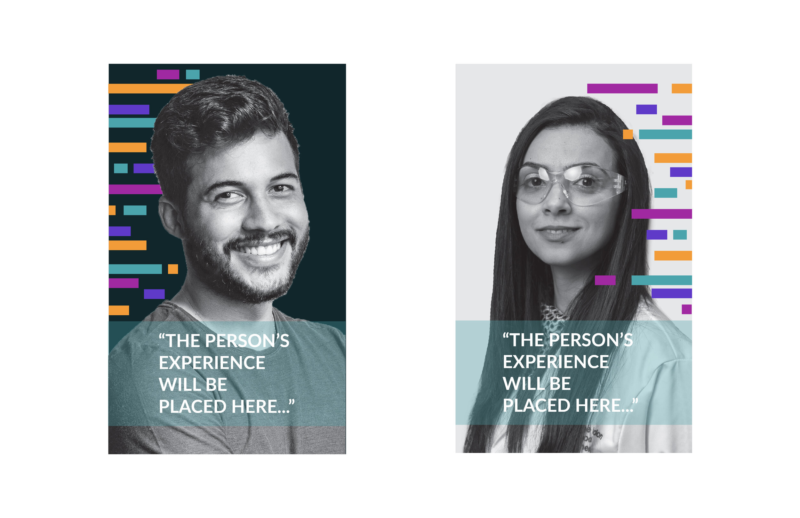
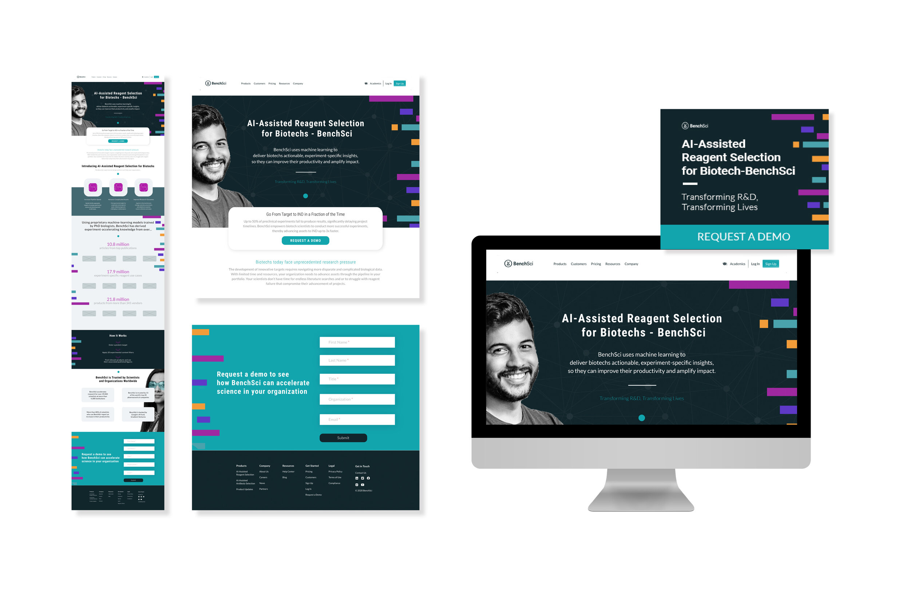
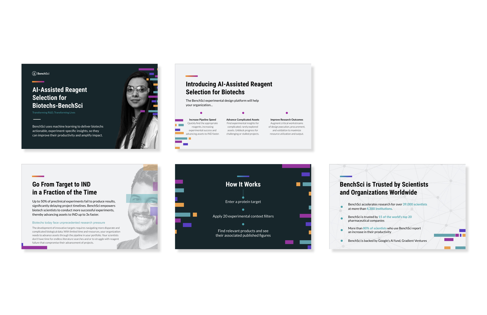

A campaign to raise awareness of BenchSci amongst biotech industry executives who lead research and development teams.

Transforming R&D, Transforming Lives is a concept focusing on how BenchSci and its products have transformed not only the pharmaceutical R&D, but the lives of patients by increasing the speed and quality of life-saving research by empowering scientists. This idea focuses on honesty and truthfulness of BenchSci and its program by sharing experience from patients and scientists.

*Posters/Banners*

*Landing Page and Online Ad*

*Google Docs Slides*
