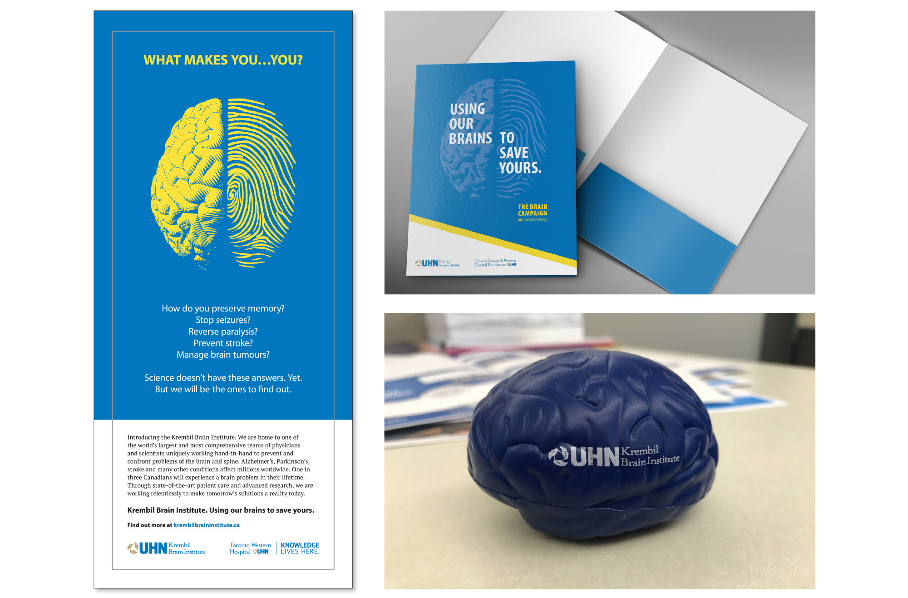
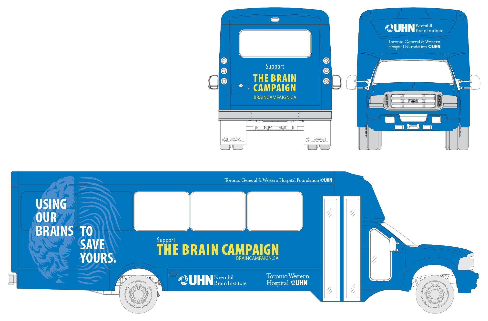
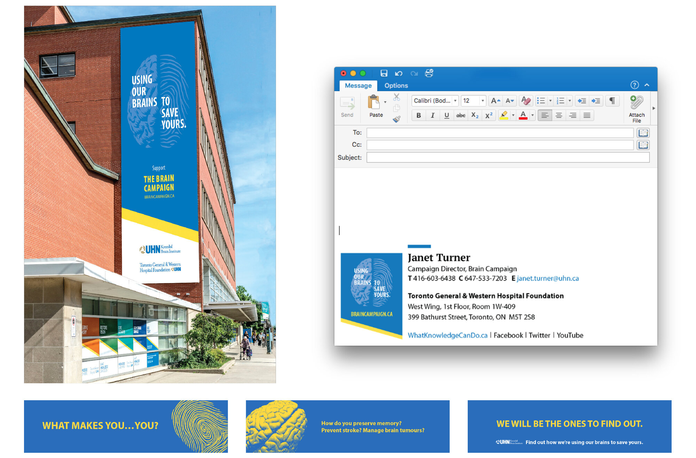
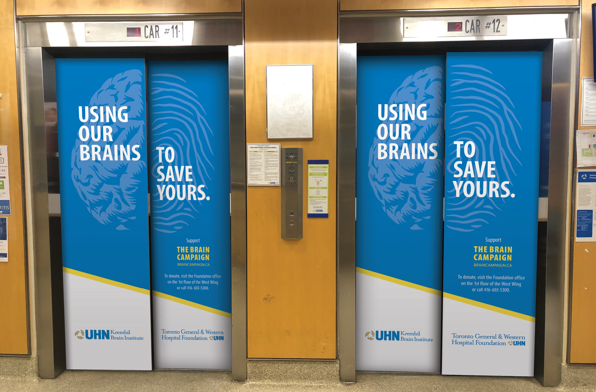

A brain graphic was designed for the campaign branding, showcasing two sides of the brain, one side with a traditional graphic, the other side using thumbprint to represent the importance of individuality.

