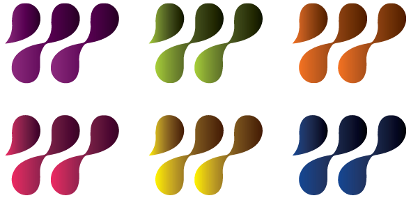
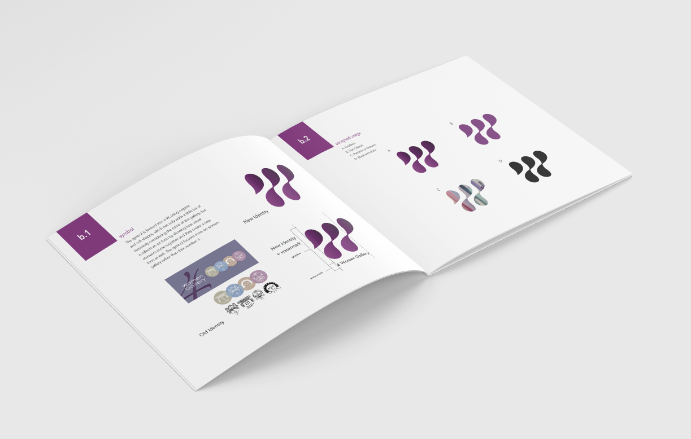
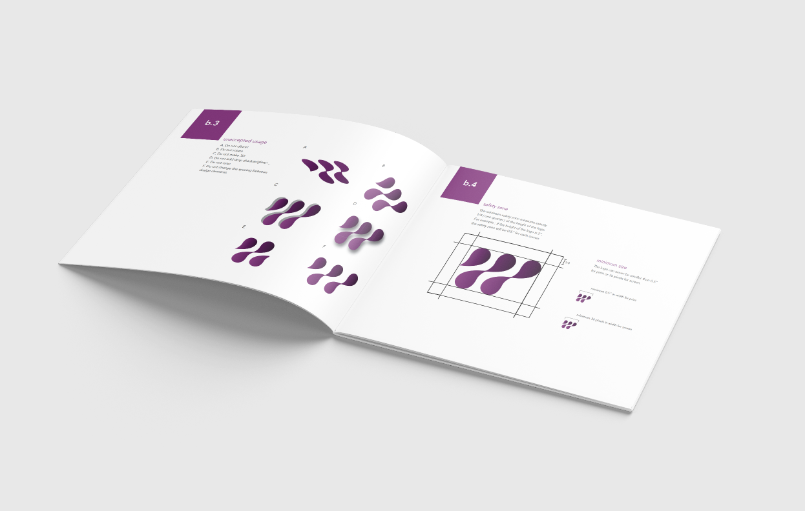
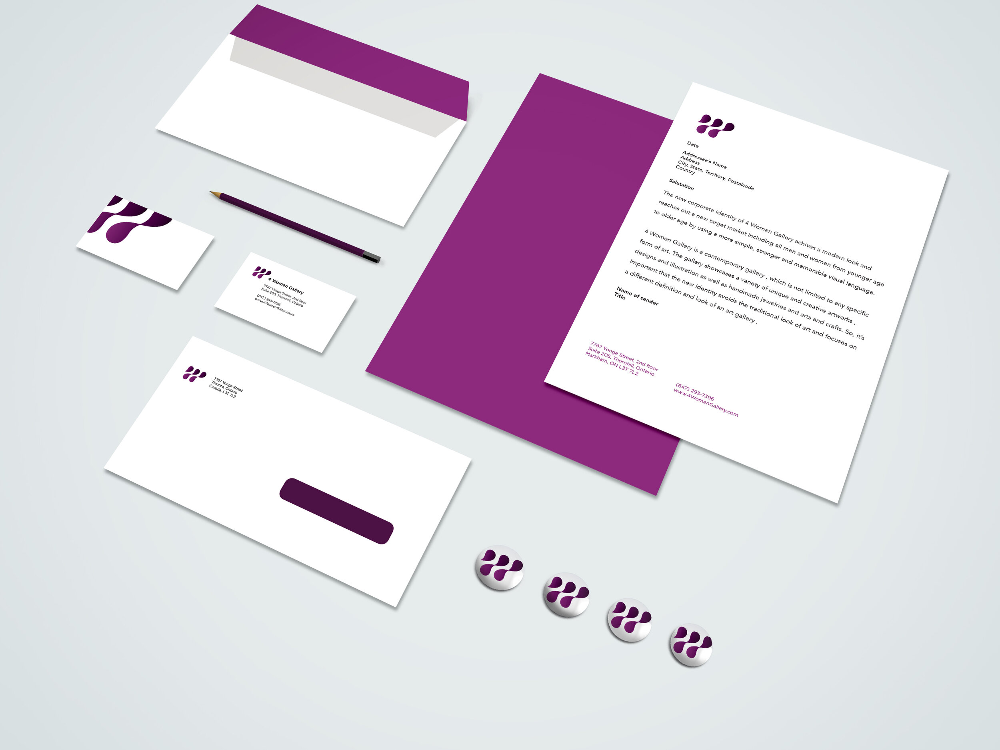
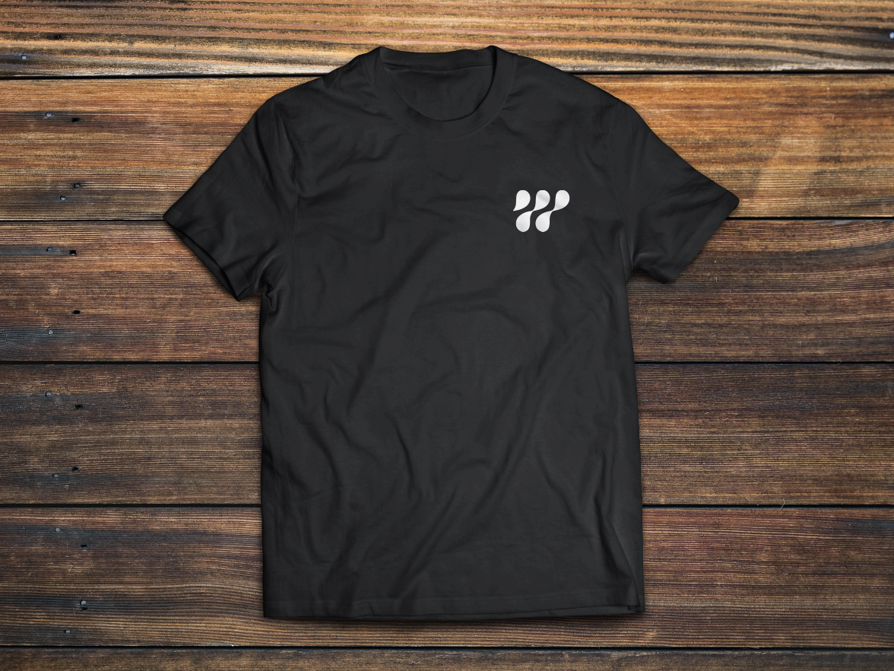
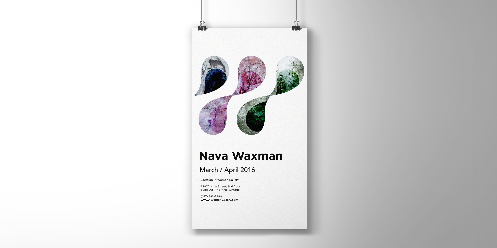
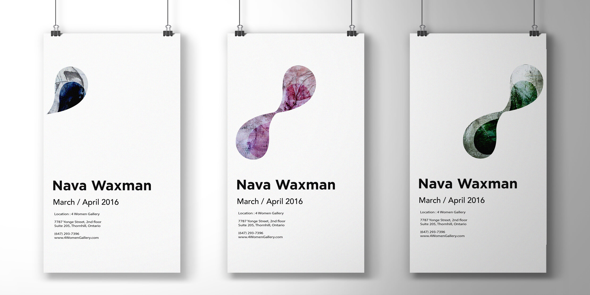
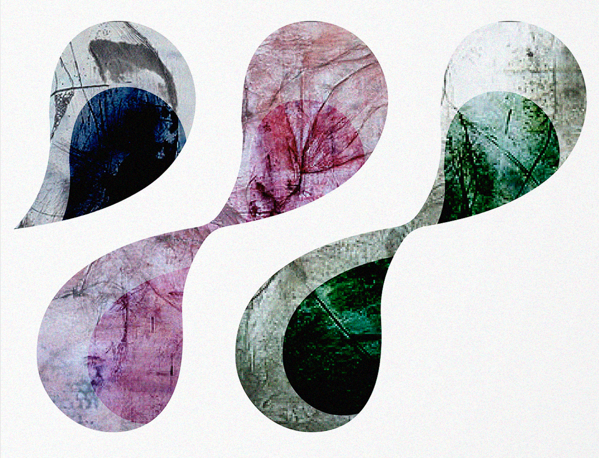
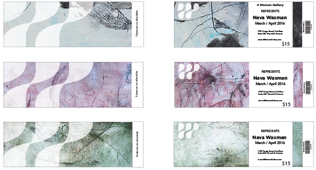
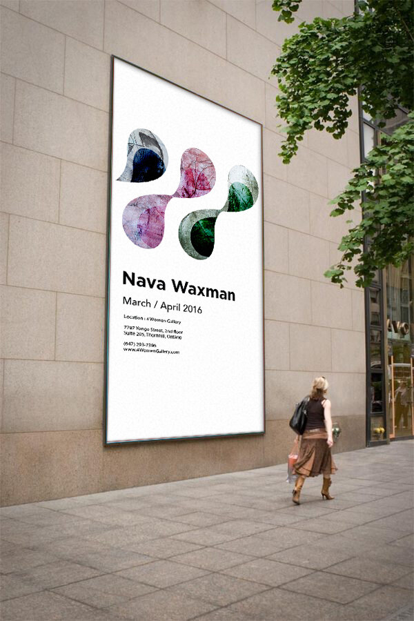

4 Women Gallery is a small contemporary gallery in Toronto Ontario, involving a variety of art and design pieces of illustrators, designers, artist and craftsmen. The new corporate identity of the gallery achieves a modern look and reaches out a new target market including all men and women from younger age to older age by using a more simple, stronger and memorable visual language.

4 Women Gallery is a contemporary gallery , which is not limited to any specific form of art. The gallery showcases a variety of unique and creative artworks , designs and illustration as well as handmade jewelries and arts and crafts.

