Ignite the Revolution Campaign for McEwen Stem Cell Institute.

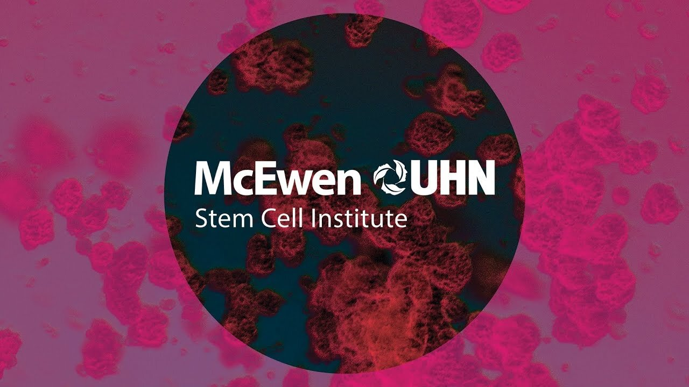

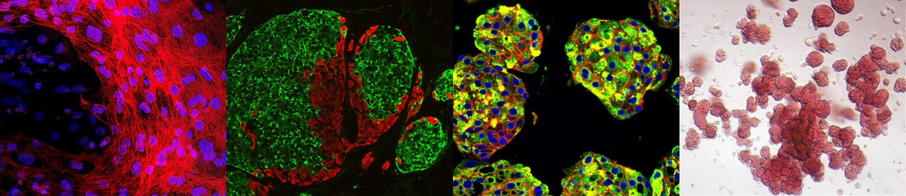

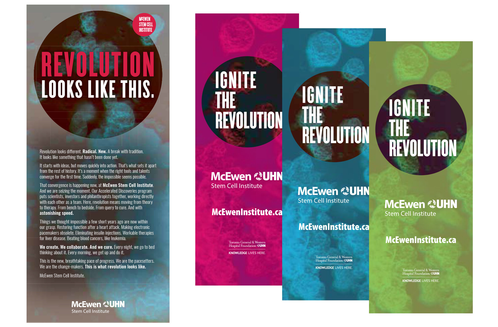

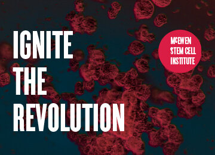

A campaign and one day event to celebrate the founding of tremendous potential of stem cells and regenerative medicine to accelerate the development of new treatments to beat blood cancers, regenerate damaged livers, eliminate insulin injections, and regenerate and repair damaged hearts by McEwen Stem Cell Institute.

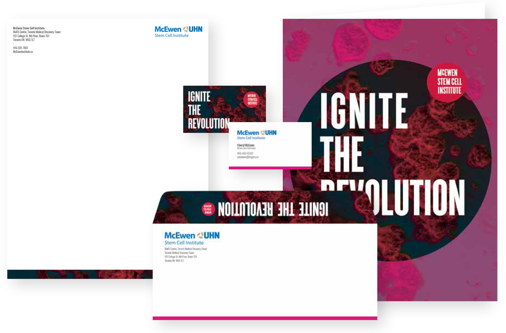

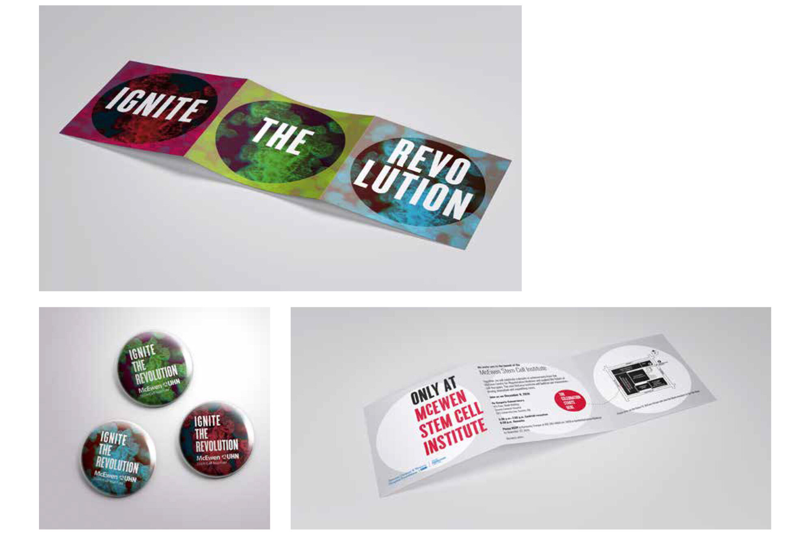

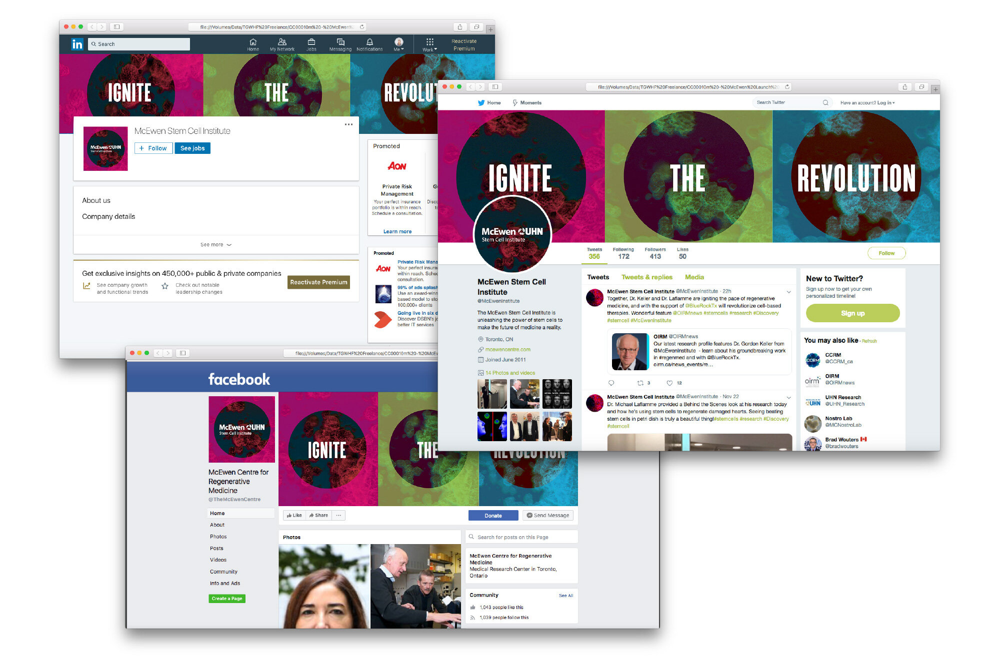

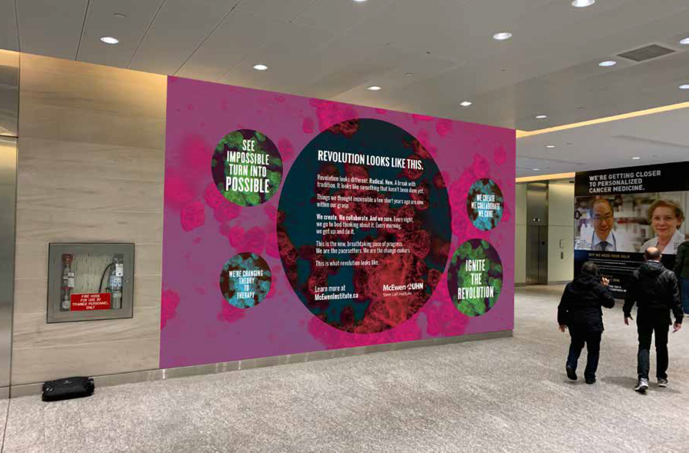

Below are floor graphics to help guiding guests as well as creating a themed experience, getting them ready to enter the event.

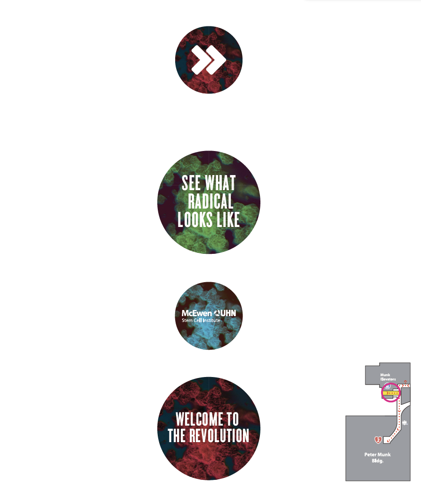

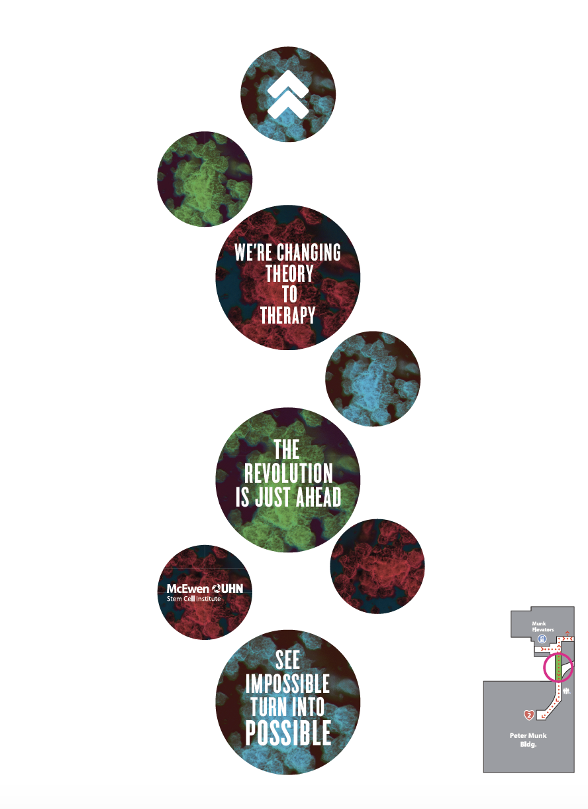

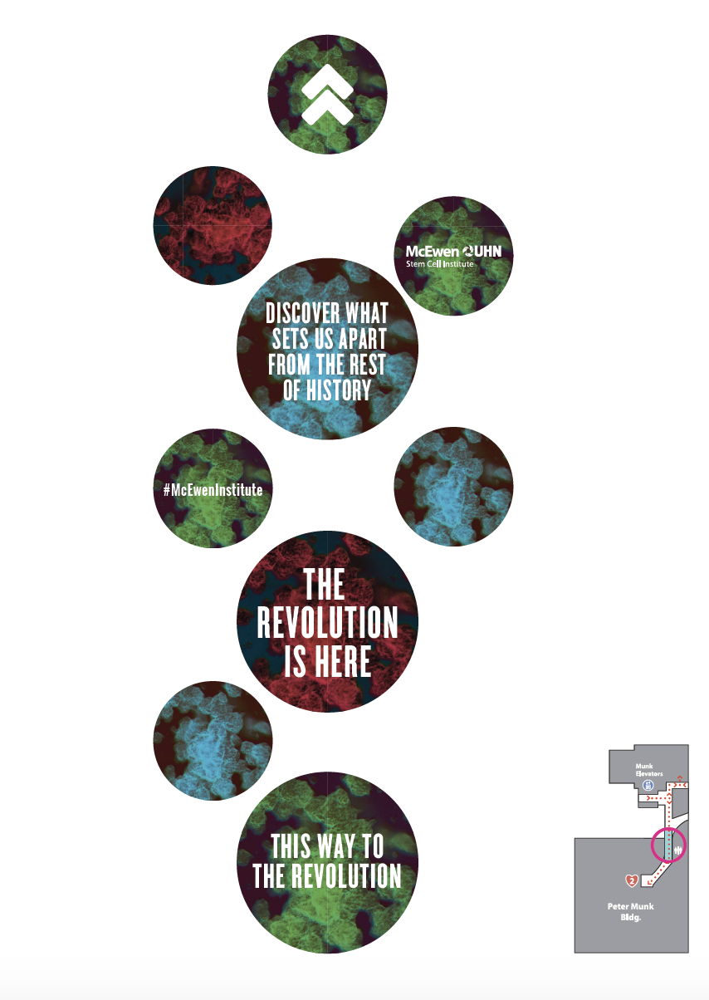

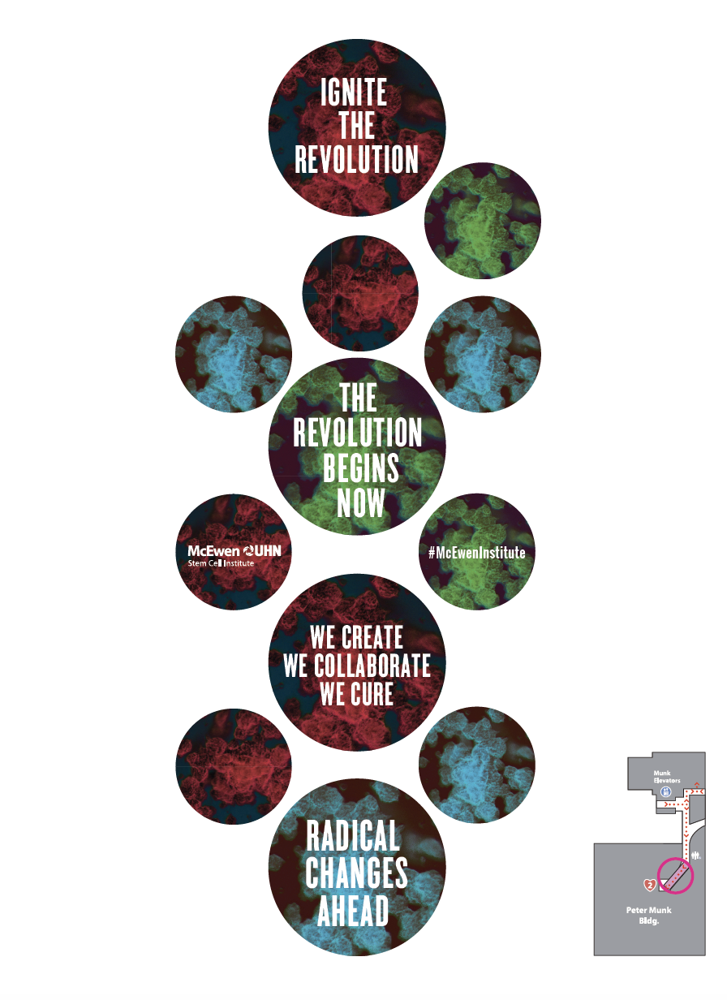

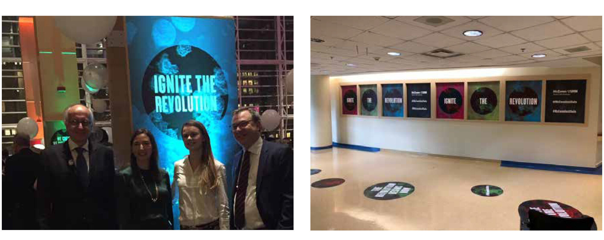
