Branded materials for Mastercard Foundation.

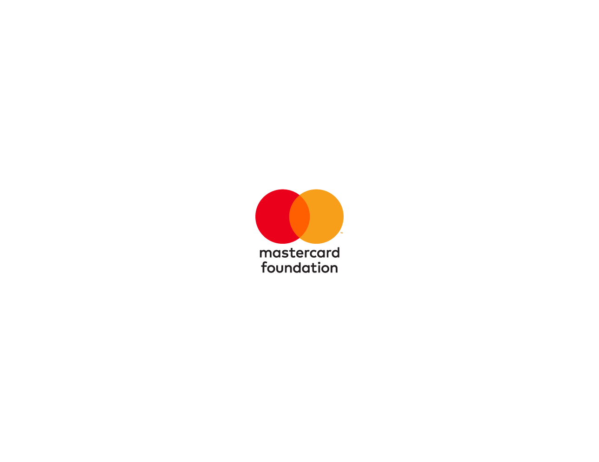

The foundation develops programs primarily in education, employment and agriculture fields, by bringing together sector, donors, young people, and civil society in order to build systems and infrastructures where young people can find work and entrepreneurs can grow.

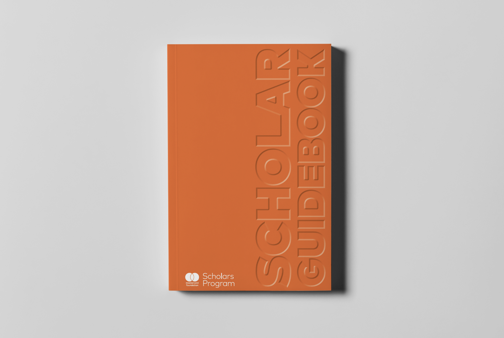

Scholar’s Handbook for the Scholars Program. A program that is developing Africa's next generation of leaders using education as the catalyst for social and economic change.

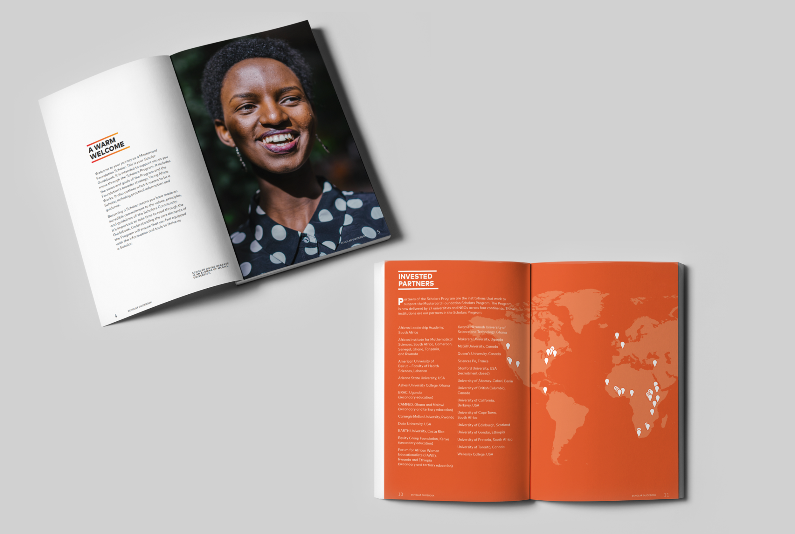

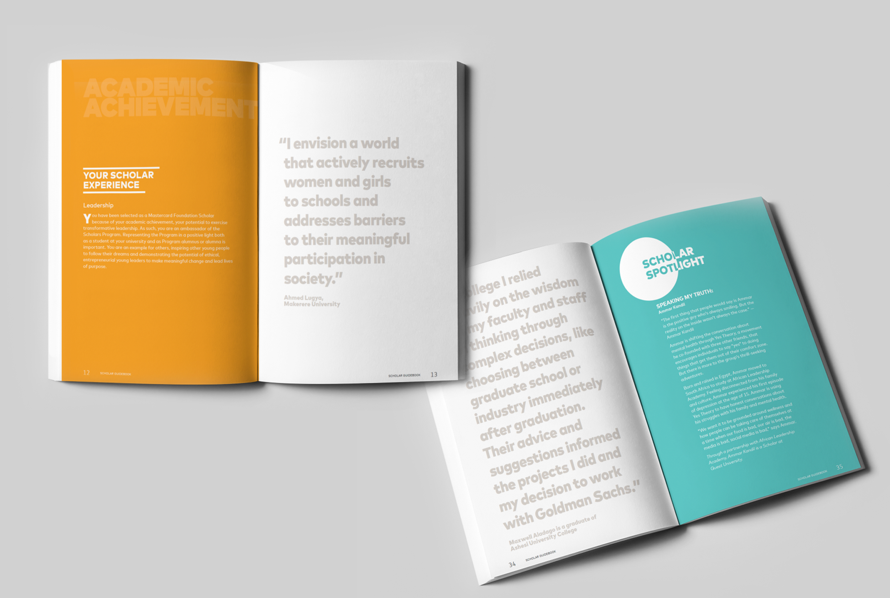

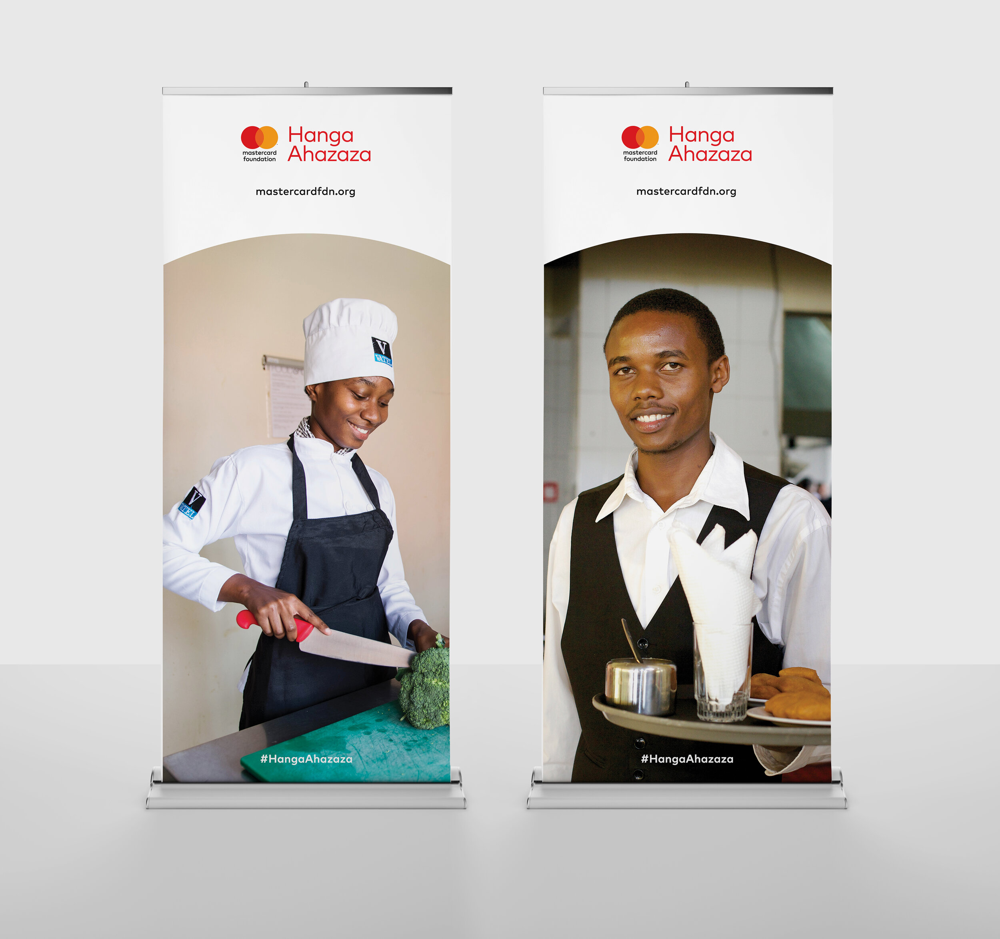

Mastercard branded applications including banners, fact sheet, brochure and web graphics.

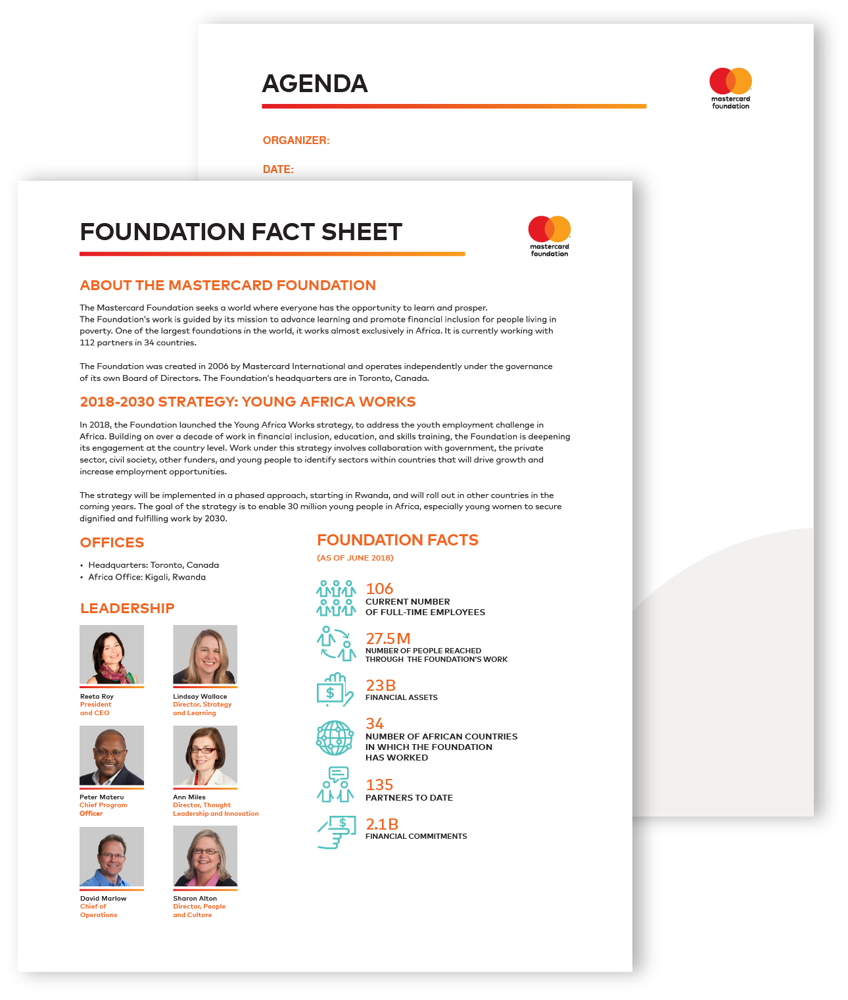

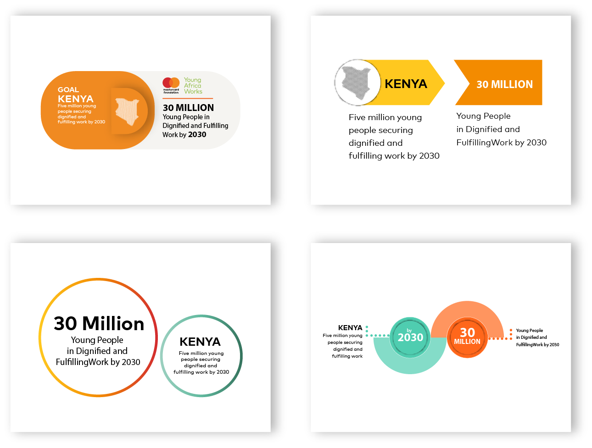

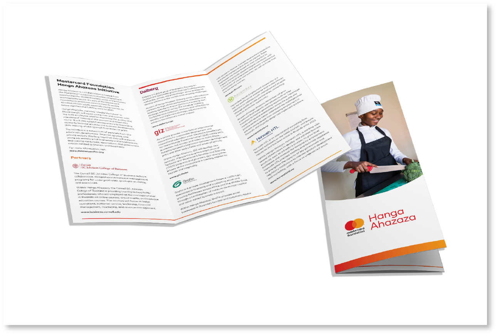

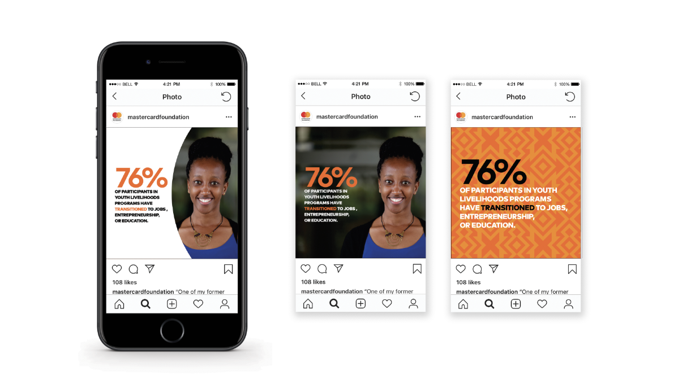

Social media graphics that would represent the look and feel of two generations and groups, “young” and “academic”.

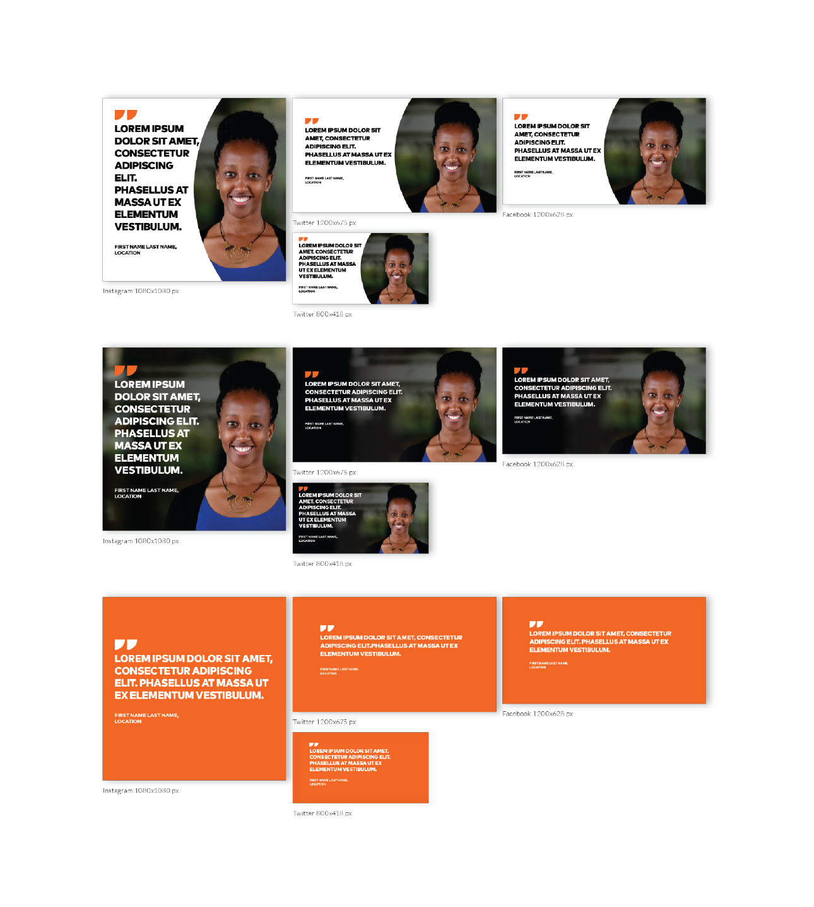

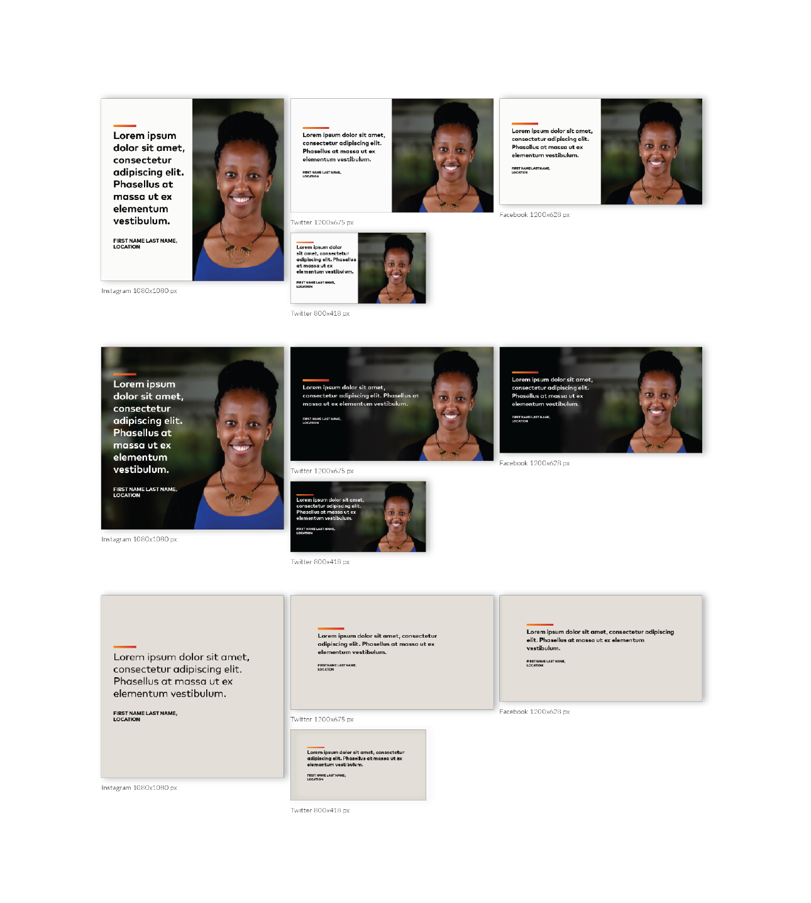
