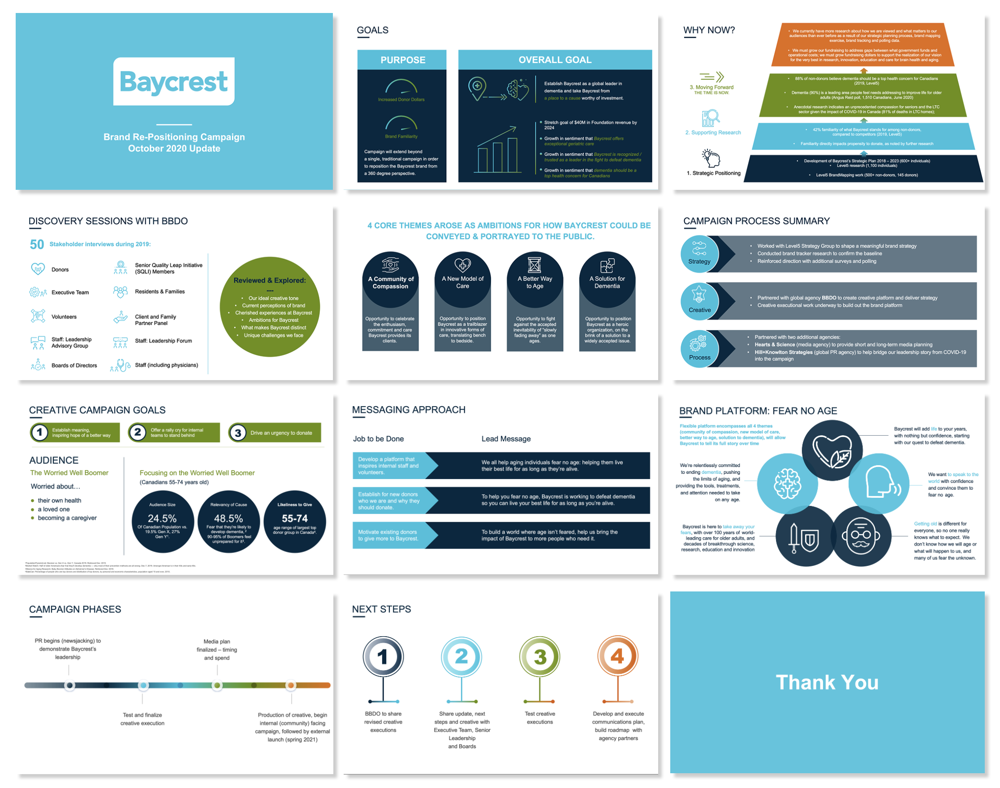
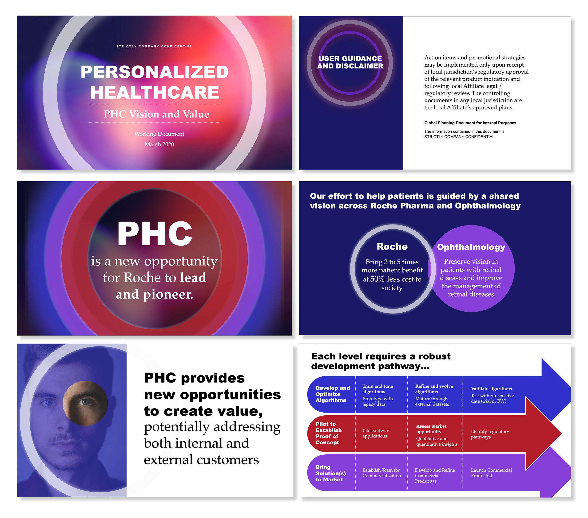
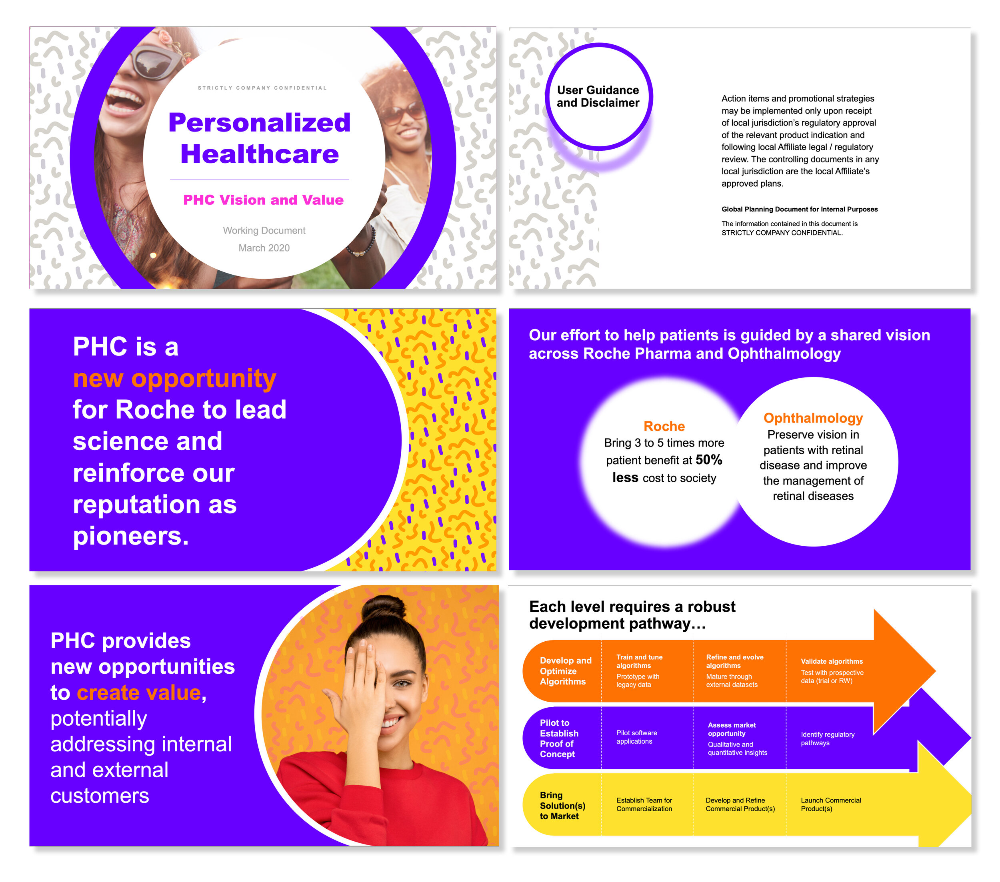
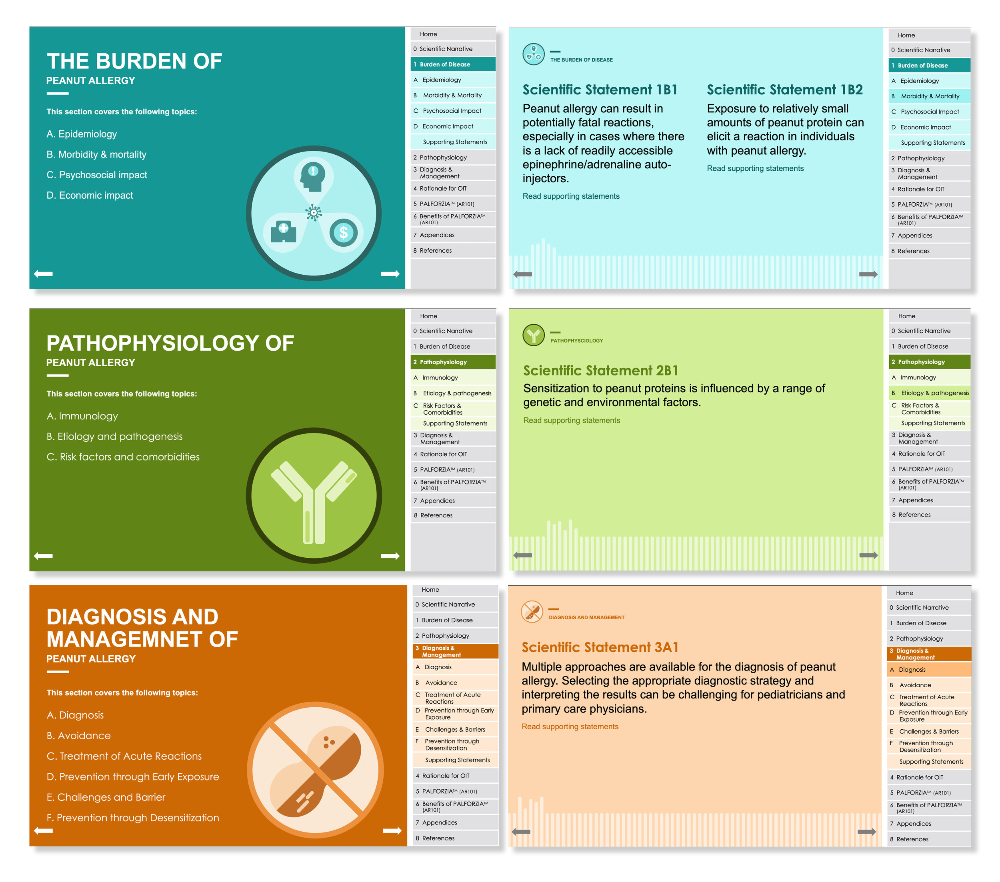
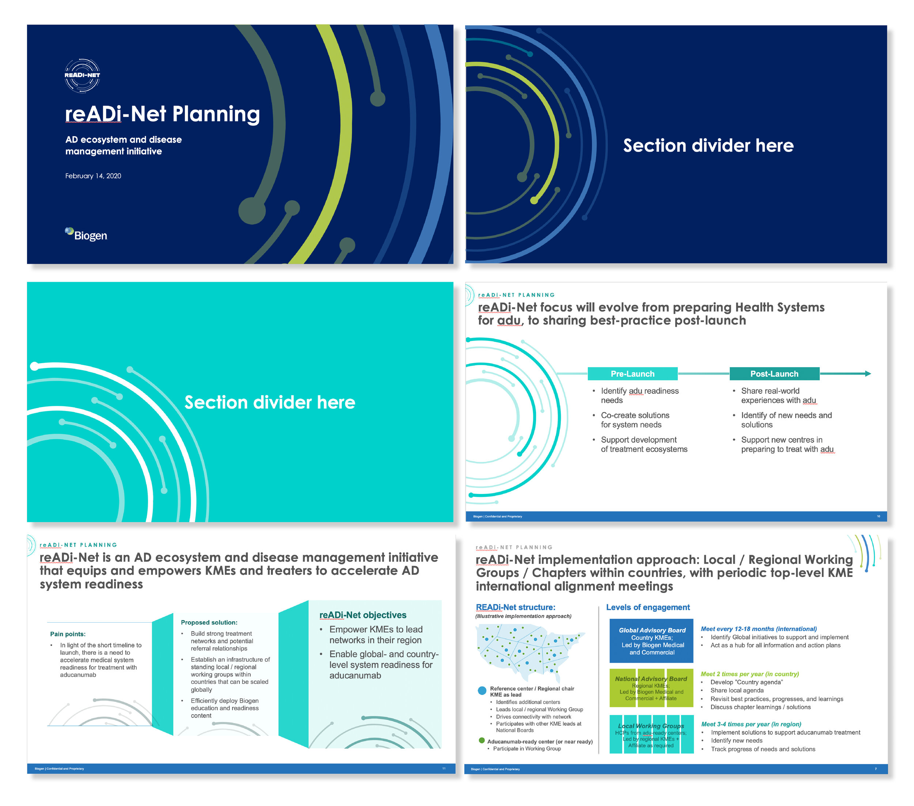
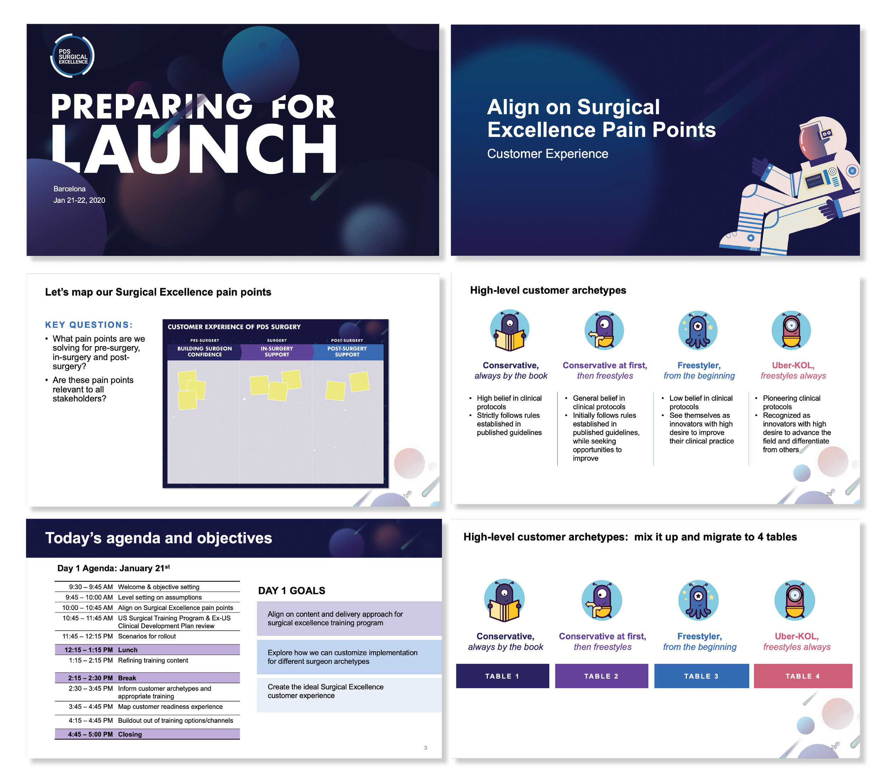
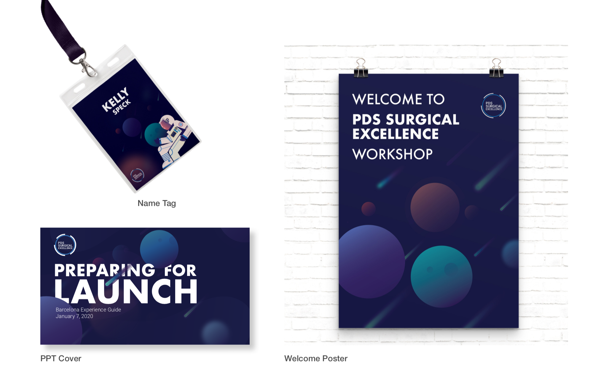

Below are examples of some pages of the pitch decks that I have designed.

*Baycrest Brand Re-Positioning Deck*

## More examples…

*PHC - Approach 1*

*PHC - Approach 2*

*Scientific Communication Platform*

*ReADi-Net*

*PDS - Surgical Excellence*

